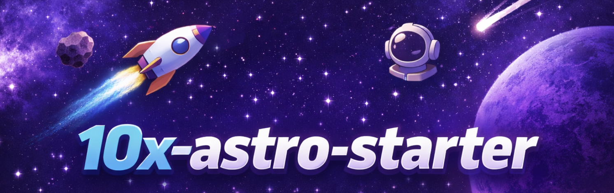

# 10x Astro Starter



A modern, opinionated starter template for building fast, accessible web applications.

## Tech Stack

- [Astro](https://astro.build/) v7 - Modern web framework with server-first rendering
- [React](https://react.dev/) v19 - UI library for interactive components
- [TypeScript](https://www.typescriptlang.org/) v6 - Type-safe JavaScript
- [Tailwind CSS](https://tailwindcss.com/) v4 - Utility-first CSS framework
- [Supabase](https://supabase.com/) - Authentication and backend-as-a-service
- [Cloudflare Workers](https://workers.cloudflare.com/) - Edge deployment runtime

## Prerequisites

- Node.js v26.13.0 (as specified in `.nvmrc`)
- npm (comes with Node.js)

## Getting Started

1. Clone the repository:

```bash
git clone https://github.com/przeprogramowani/10x-astro-starter.git
cd 10x-astro-starter
```

2. Install dependencies:

```bash
npm install
```

3. Set up Supabase and configure environment variables — see [Supabase Configuration](#supabase-configuration) below.

4. Create a `.dev.vars` file for local Cloudflare dev secrets:

```bash
cp .env.example .dev.vars
```

5. Run the development server:

```bash
npm run dev
```

## Available Scripts

- `npm run dev` - Start development server (Cloudflare workerd runtime)
- `npm run build` - Build for production
- `npm run preview` - Preview production build
- `npm run lint` - Run ESLint with type-checked rules
- `npm run lint:fix` - Auto-fix ESLint issues
- `npm run format` - Run Prettier
- `npm run smoke` - Smoke test the auth flow against a running server (`BASE_URL`, defaults to `http://localhost:4321`)

## Project Structure

```md
.
├── src/
│ ├── layouts/ # Astro layouts
│ ├── pages/ # Astro pages
│ │ └── api/ # API endpoints
│ ├── components/ # UI components (Astro & React)
│ └── assets/ # Static assets
├── public/ # Public assets
├── wrangler.jsonc # Cloudflare Workers config
```

## Supabase Configuration

This project uses [Supabase](https://supabase.com/) for authentication. Environment variables are declared via Astro's `astro:env` schema and are treated as **server-only secrets** — they are never exposed to the client.

### First-time setup (local, no cloud project needed)

Requires [Docker](https://www.docker.com/) and ~7 GB RAM.

1. Create your `.env` file:

```bash
cp .env.example .env
```

2. Initialize the local Supabase project (creates a `supabase/` config folder):

```bash
npx supabase init
```

3. Start the local stack (downloads Docker images on first run):

```bash
npx supabase start
```

4. Copy the credentials printed by the CLI into your `.env` and `.dev.vars`:

```
SUPABASE_URL=http://127.0.0.1:54321
SUPABASE_KEY=<anon key from CLI output>
```

5. To stop the stack when done:

```bash
npx supabase stop
```

The local Studio UI is available at `http://localhost:54323`.

Authentication uses Supabase Auth's built-in `auth.users` table. Application tables (groups, children, events, declarations) are defined as SQL migrations in `supabase/migrations/`, each with RLS enabled. Apply them to the local stack with `npx supabase db reset`.

### Using a cloud Supabase project instead

If you prefer to use a hosted Supabase project, add these variables to your `.env` and `.dev.vars` files:

| Variable       | Description                                                |
| -------------- | ---------------------------------------------------------- |
| `SUPABASE_URL` | Project URL from Supabase dashboard → Settings → API       |
| `SUPABASE_KEY` | `anon` public key from Supabase dashboard → Settings → API |

```
SUPABASE_URL=https://<project-ref>.supabase.co
SUPABASE_KEY=<anon-key>
```

### Email confirmation is disabled everywhere

The app sends no e-mails (PRD), and group auto-join (FR-006) needs the user signed in right after sign-up, so **e-mail confirmation is off in every environment**: locally (`enable_confirmations = false` in `supabase/config.toml`) and in the hosted project (dashboard → **Authentication → Sign In / Providers → Email → Confirm email** off). A successful sign-up returns a session and lands on `/dashboard`. Minimum password length is 6 in both places.

### Sessions

Sessions last until the user clicks "Wyloguj" (FR-002). `[auth.sessions]` in `supabase/config.toml` is deliberately left unset (no timebox, no inactivity timeout); `@supabase/ssr` stores the auth cookies with a long `maxAge` and the middleware refreshes the access token on each request.

### Database migrations

Schema lives in `supabase/migrations/` (`YYYYMMDDHHmmss_short_description.sql`, RLS enabled in the same file); pgTAP tests live in `supabase/tests/`.

```bash
npx supabase db reset     # recreate the local DB and apply all migrations (drops local data)
npx supabase test db      # run the RLS/trigger tests
npx supabase db push      # apply to the hosted project — BEFORE merging a migration PR
npx supabase migration list   # confirm Local and Remote match
```

Workers Builds deploys `main` immediately, so a migration must already be on the hosted project when its PR merges.

### Auth routes

| Route          | Description                                                               |
| -------------- | ------------------------------------------------------------------------- |
| `/auth/signin` | E-mail/password sign-in form                                              |
| `/auth/signup` | Sign-up form (first name, nick, e-mail, optional phone, password)         |
| `/dashboard`   | Post-login screen with the profile greeting (redirects to `/auth/signin`) |

Route protection is handled in `src/middleware.ts`. Add paths to the `PROTECTED_ROUTES` array there to require authentication. The middleware also loads the signed-in user's row from `public.profiles` into `Astro.locals.profile`.

## Deployment

Production runs on [Cloudflare Workers](https://workers.cloudflare.com/) at **https://carpooling.pstawik.workers.dev**. The full setup and its audit trail are in `context/changes/deployment/deployment-plan.md`.

- **Auto-deploy.** Every push to `main` is built and deployed by Cloudflare Workers Builds (`npm run build`, then `npx wrangler deploy`). There is no GitHub Actions deploy job. Builds for preview branches are off.
- **Merging is the approval.** The `protect-main` ruleset requires a PR with green `ci` and `smoke` checks and blocks direct and force pushes. Workers Builds doesn't wait for GitHub Actions, so the ruleset is what stops a broken commit from reaching production.
- **Secrets.** `SUPABASE_URL` and `SUPABASE_KEY` (the anon/publishable key, never `service_role`) are Worker secrets, under Settings → Variables & Secrets. Set them with `npx wrangler secret put <NAME>` in a real terminal: `!` in Claude Code runs non-interactively and stores an empty value. Don't add them as Build variables.
- **Placement.** `wrangler.jsonc` pins the Worker to `aws:eu-west-2`, next to the Supabase project. `preview_urls` is `false` because preview URLs would share production secrets.
- **After each deploy,** run the read-only smoke: `BASE_URL=https://carpooling.pstawik.workers.dev SMOKE_READONLY=1 npm run smoke`.
- **Rollback (human-only).** A failed build leaves the previous version live. For a bad deployed version:

  ```bash
  npx wrangler deployments list
  npx wrangler rollback <version-id> -m "<reason>"
  ```

  Then revert or fix on `main` as well, or the next push redeploys the bad code.

- **Manual deploy** (break-glass only): `npm run build && npx wrangler deploy`.

## Smoke test

`scripts/smoke.mjs` is a dependency-free Node script that walks the whole auth flow (sign-up, sign-in, protected page, sign-out) over HTTP. Run it against the dev server or the production preview after dependency upgrades:

```bash
npm run dev            # or: npm run build && npm run preview
BASE_URL=http://localhost:4321 npm run smoke
```

It needs a reachable Supabase instance (local or cloud) with email confirmation disabled.

Against production, always set `SMOKE_READONLY=1`. It skips every step that creates users or sessions and checks only that the home page renders and that `/dashboard` redirects anonymous users.

> **Note:** this script exists primarily to guard the development of the starter itself — it is a fast sanity check that dependency upgrades did not break the build, the Cloudflare adapter or the Supabase auth flow. It is **not** a substitute for a real test suite. Once you build your own product on top of this starter, add proper tests (unit, integration, end-to-end) suited to your application.

## CI

GitHub Actions runs two jobs on every push and PR to `main`:

- **ci** — lint, `astro check` and build. Configure `SUPABASE_URL` and `SUPABASE_KEY` as repository secrets for the build step.
- **smoke** — starts a local Supabase via the Supabase CLI (which applies `supabase/migrations/`), runs `supabase test db`, builds, serves the production preview on the Cloudflare runtime and runs `npm run smoke` against it. No secrets required.

Both jobs are required checks for merging to `main`. Deploying is not done by CI: Cloudflare Workers Builds deploys `main` on its own (see [Deployment](#deployment)).

## License

MIT
